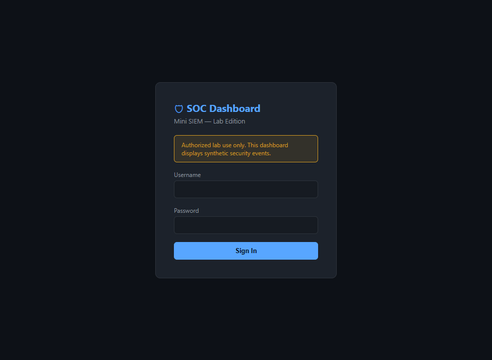
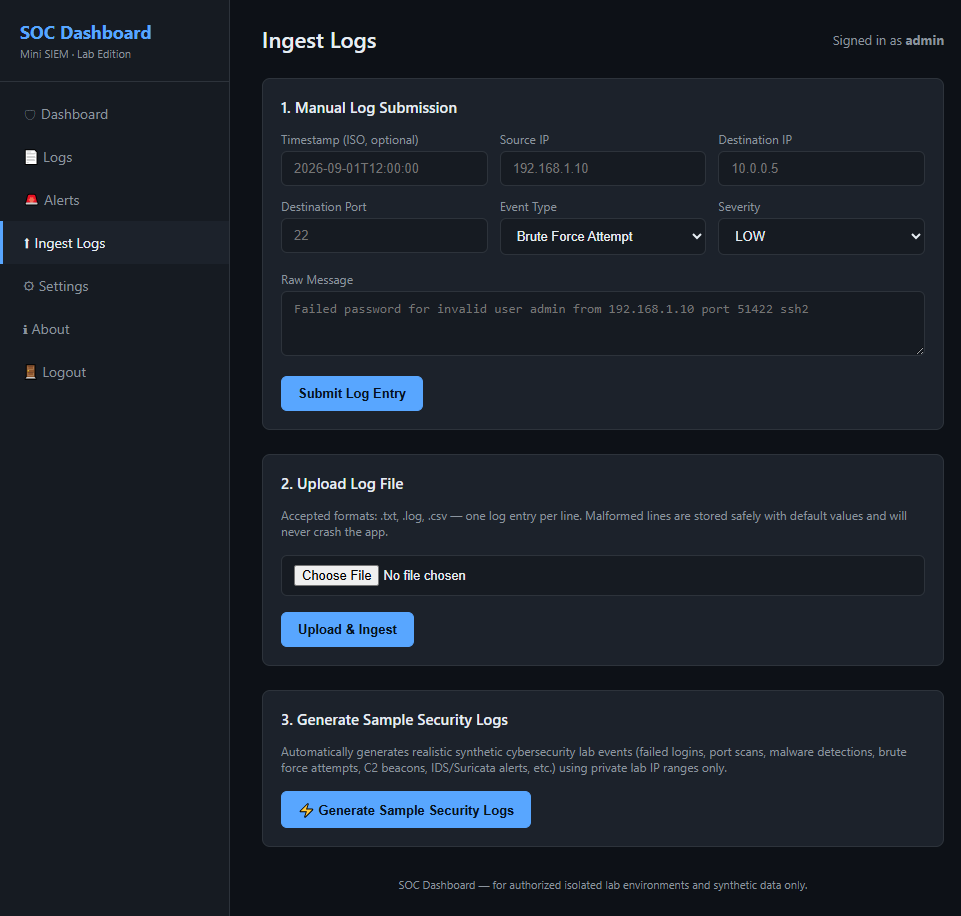
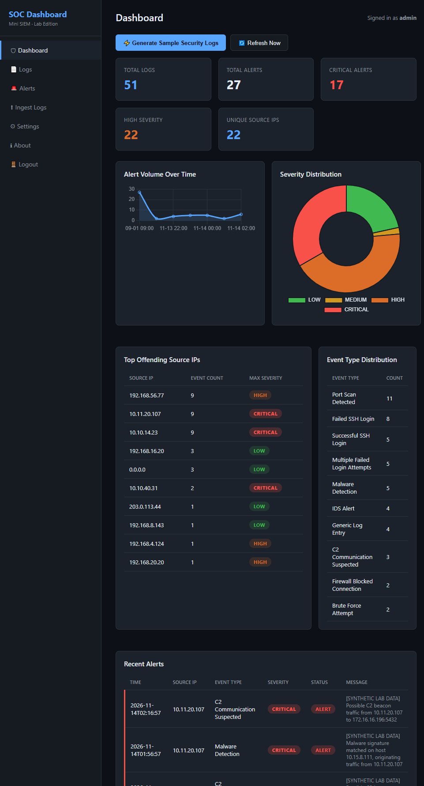
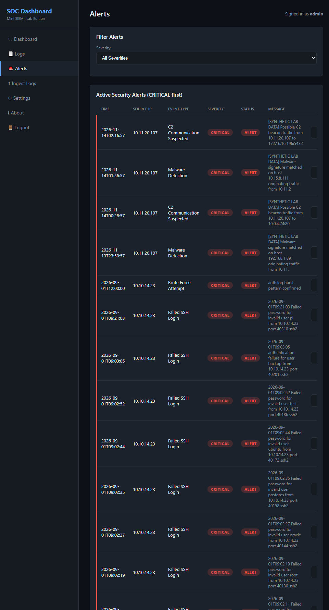
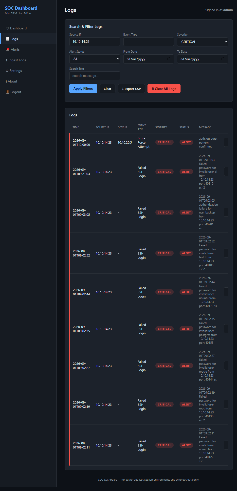

# SOC Dashboard — Mini SIEM

A self-hosted Security Operations Center dashboard built from first principles:
ingestion, parsing, normalization, SQLite storage, threshold-based detection and
an authenticated analyst interface. Built as the capstone for the **MSAK IT Hub
Defensive Security internship (Task 6)**.


[](https://github.com/jameel066/soc-dashboard/actions/workflows/tests.yml)

> **Lab use only.** The dashboard is designed for an isolated environment with
> synthetic or sanitised logs. It is a teaching tool, not a production SIEM.

---

## What it does

```
manual entry / file upload / sample generator
        │
        ▼
   log ingestion ──► parsing ──► normalization ──► SQLite
                                                     │
                                                     ▼
                                        threshold-based detection
                                        (brute force, port scan,
                                         repeated suspicious activity)
                                                     │
                                                     ▼
                                     Flask JSON API  ──►  dashboard UI
```

- **Three ingestion paths** — a manual form, `.txt` / `.log` / `.csv` upload, and
  a synthetic lab-event generator.
- **Format-agnostic parser** — recognises CSV rows and free-text lines, extracts
  timestamp, source/destination IP, port, event type and severity. Malformed
  lines are stored safely instead of aborting the import.
- **Three detection routines** — failed-login bursts per source IP, distinct
  destination-port sweeps, and repeated suspicious events, all evaluated inside
  a configurable rolling window.
- **Analyst views** — overview cards, timeline and severity charts, a
  severity-sorted alerts page, filterable log search, per-event detail, and CSV
  export.
- **Authentication** — scrypt password hashes, session-based access control on
  every route and API endpoint.

---

## Screenshots

| Login | Log ingestion |
| --- | --- |
|  |  |

**Dashboard overview** — statistic cards, alert-volume timeline, severity
distribution, top offending source IPs, event-type breakdown and the recent
alerts feed.



| Alerts (CRITICAL first) | Filtered investigation |
| --- | --- |
|  |  |

---

## Quick start

```powershell
git clone https://github.com/jameel066/soc-dashboard.git
cd soc-dashboard
python -m venv venv
.\venv\Scripts\Activate.ps1
pip install -r requirements.txt
python dashboard.py
```

Open <http://127.0.0.1:5000>. On first run the application creates
`soc_dashboard.db`, seeds 20 synthetic events, and prints a randomly generated
administrator password **once**:

```
==================================================================
 First run — administrator account created
   username : admin
   password : <generated>
 This password is shown once and is not stored in plaintext.
==================================================================
```

To choose the password yourself on a fresh database:

```powershell
$env:SOC_ADMIN_PASSWORD = "YourStrongPassword"
python dashboard.py
```

To load the prepared sample scenario (brute-force burst, port-scan sweep,
routine traffic, malformed lines):

```powershell
# sign in, open Log Ingestion, upload sample-logs/sample-auth.log
```

---

## Configuration

Everything is environment-driven; no secrets live in the repository.

| Variable | Default | Purpose |
| --- | --- | --- |
| `SOC_SECRET_KEY` | auto-generated | Session signing key. If unset, a key is created in `.secret_key` with owner-only permissions |
| `SOC_ADMIN_PASSWORD` | random | Sets the first-run administrator password |
| `SOC_DATABASE` | `soc_dashboard.db` | SQLite file location |
| `SOC_HOST` | `127.0.0.1` | Bind address |
| `SOC_PORT` | `5000` | Bind port |
| `SOC_DEBUG` | off | Enables the Werkzeug debugger. **Never enable on a reachable host** |
| `SOC_COOKIE_SECURE` | off | Set to `1` when serving over HTTPS |
| `SOC_LOGIN_MAX_ATTEMPTS` | `10` | Failed logins per IP before throttling |
| `SOC_LOGIN_WINDOW_SECONDS` | `300` | Throttle window |

---

## Detection rules

| Rule | Signal | Fires when |
| --- | --- | --- |
| Brute force | Events typed `Failed SSH Login`, `Multiple Failed Login Attempts`, `Brute Force Attempt` | `count >= threshold` from one source IP inside the window |
| Port scan | Rows with a destination port | `distinct ports >= threshold` from one source IP inside the window |
| Suspicious activity | Any event in the suspicious-event set | `count >= threshold` from one source IP inside the window |

Defaults: **5 events in 5 minutes**, editable on the Settings page. Matches are
marked `ALERT`; brute-force matches are escalated to `CRITICAL`, port scans to
`HIGH`.

---

## API

All endpoints require an authenticated session and return JSON.

| Endpoint | Returns |
| --- | --- |
| `/api/dashboard` | Summary counters |
| `/api/logs` | Filtered log rows |
| `/api/alerts` | Alert rows, severity-sorted |
| `/api/top-offenders` | Top 10 source IPs by event count |
| `/api/timeline` | Hourly event buckets for the trend chart |
| `/api/severity` | Counts by severity for the doughnut chart |

---

## Security

The repository ships no default password, no hardcoded signing key and no
committed database. See [`SECURITY.md`](SECURITY.md) for the threat model and
the operator checklist.

| Area | Implementation |
| --- | --- |
| Password storage | Werkzeug scrypt hash, per-password salt |
| Sessions | Signed cookie, `HttpOnly`, `SameSite=Lax`, 8-hour lifetime, optional `Secure` |
| CSRF | Per-session token required on every `POST`, constant-time comparison |
| Open redirect | `?next=` restricted to site-relative paths |
| Login throttling | 10 failures per IP per 5 minutes |
| SQL | Parameterised queries only |
| Errors | Generic message to the browser, full traceback to the server log |
| Debugger | Off by default, opt-in only |

**Scope limit:** this is a lab tool. There is no TLS, no RBAC, no persistent
lockout, and no protection against a local administrator.

---

## Tests

```powershell
python -m unittest discover -s tests -v
```

18 tests cover log parsing (CSV, free text, malformed input), redirect
validation, CSRF rejection, the login flow and route protection. CI runs them on
Windows for Python 3.9 and 3.12.

---

## Documentation

| Document | Contents |
| --- | --- |
| [`docs/PROJECT-REPORT.md`](docs/PROJECT-REPORT.md) | Full capstone report — architecture, features, screenshots, testing, lessons learned |
| [`docs/SOC-Dashboard-Report.pdf`](docs/SOC-Dashboard-Report.pdf) | The same report as a print-ready PDF |
| [`SECURITY.md`](SECURITY.md) | Threat model, controls, operator checklist |

---

## Project layout

```
dashboard.py                 single-file Flask application
requirements.txt             Flask only
sample-logs/sample-auth.log  prepared lab scenario
tests/test_core.py           parsing, CSRF, auth and redirect tests
docs/PROJECT-REPORT.md       full capstone report
docs/SOC-Dashboard-Report.pdf
docs/screenshots/            UI captures
.github/workflows/tests.yml  CI: Windows, Python 3.9 and 3.12
```

---

## Project context

Built during the **MSAK IT Hub Defensive Security Internship — Task 6
(Capstone)** under instructor Talha Haneef. All testing used non-routable RFC 1918
addresses in an isolated lab; no production system or third-party network was
touched.

## License

MIT — see [`LICENSE`](LICENSE).
