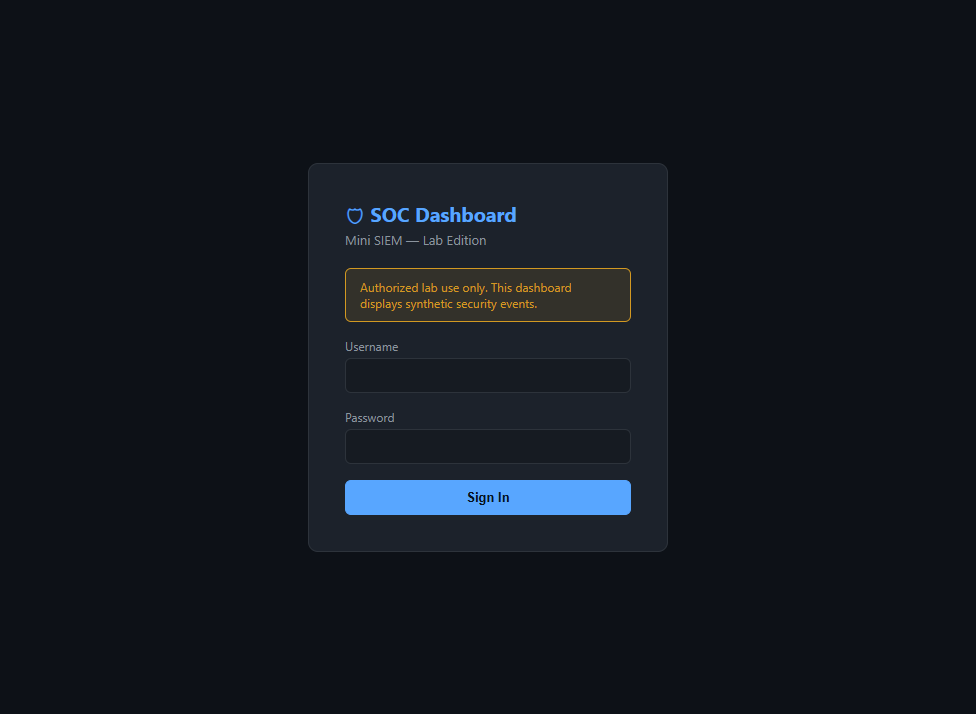
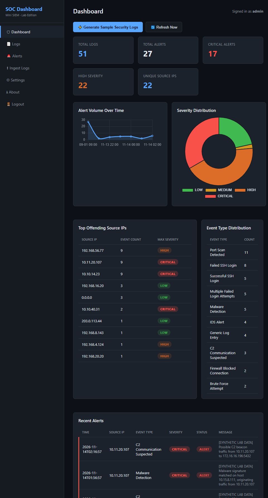
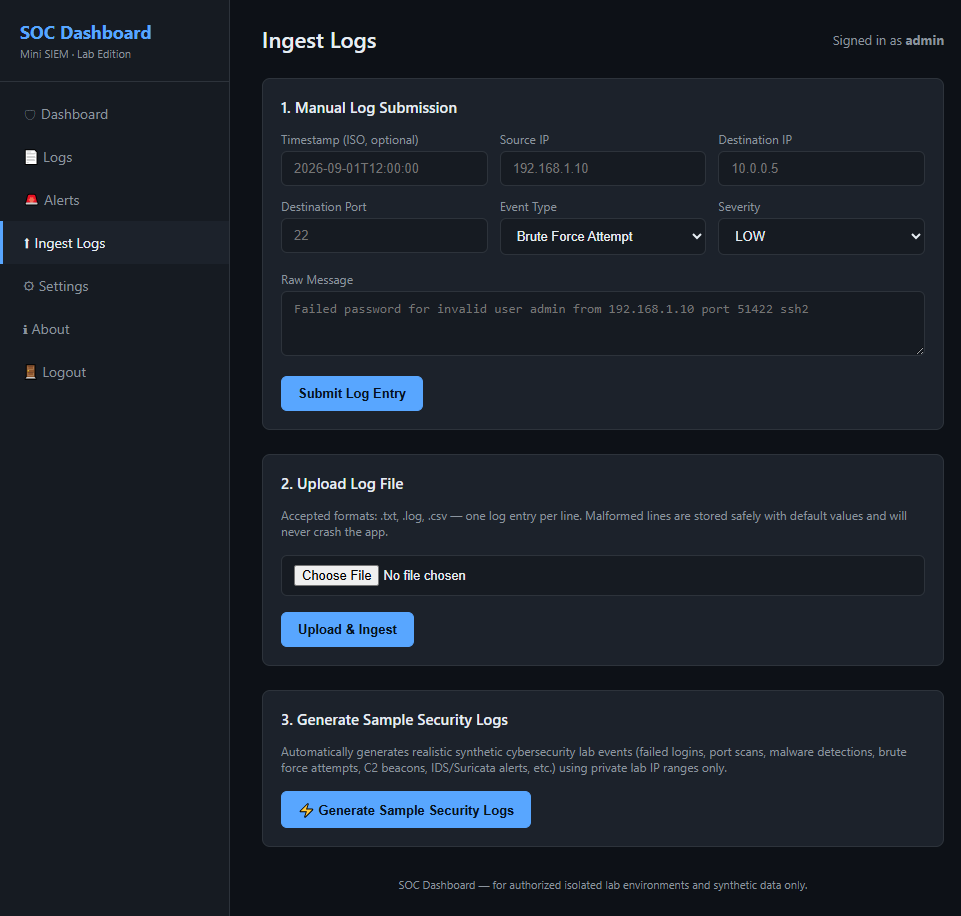
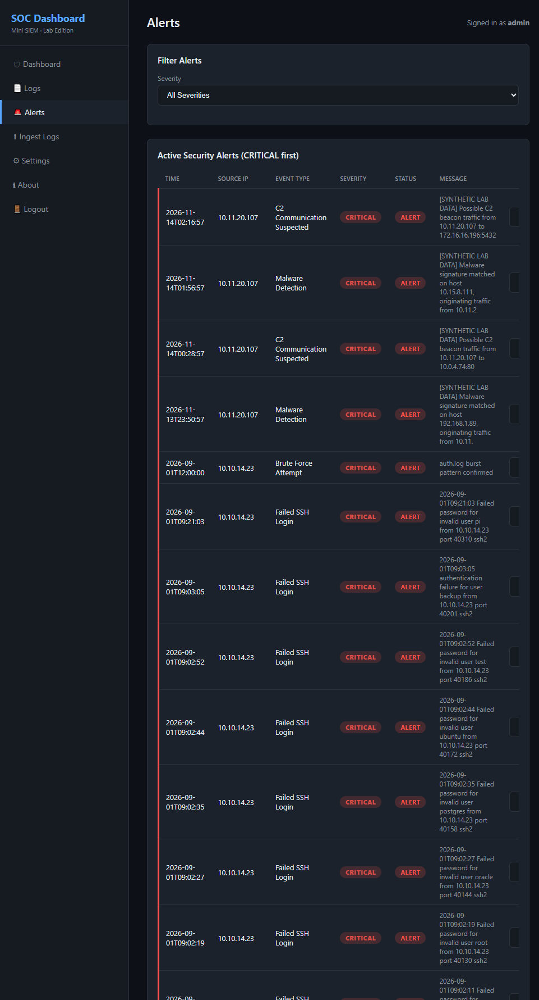
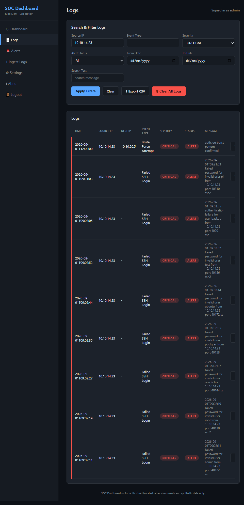

# SOC Dashboard — Mini SIEM

**Capstone Project Report · Task 6 — Defensive Security**

MSAK IT Hub · Defensive Security Internship
Prepared by **Muhammad Jameel**
Instructor: Talha Haneef · Assessment date: 1 September 2026

---

## Executive summary

This report documents the design, implementation and testing of a self-hosted
**SOC Dashboard**, a lightweight Mini-SIEM front-end that demonstrates how a
security monitoring platform works internally. The application is written in
Python with Flask and SQLite, with a Chart.js front end and Werkzeug password
hashing. It was built and tested entirely inside an authorised, isolated
laboratory environment.

The pipeline is deliberately linear and explicit: security logs arrive through a
manual form, a file upload, or a synthetic generator; a parser extracts
structured fields; a normalisation layer maps every input format onto one schema;
SQLite persists the events; a threshold engine flags brute-force, port-scan and
repeated-suspicious-activity patterns; and an authenticated dashboard presents
statistics, charts, alerts, search and per-event detail to the analyst.

The captured demonstration dataset contains **51 events**, of which **27** were
flagged as alerts (**17 CRITICAL**). Validation covered 15 functional test cases,
all of which passed, plus **19 automated unit tests** covering parsing, redirect
validation, CSRF enforcement, the login flow and schema recovery.

Before publication the code was reviewed as an attacker would review it. Eight
findings were confirmed and fixed — among them a shipped default password, a
hardcoded session key, an exposed debug console, missing CSRF protection and an
open redirect. Section 10 documents each finding and its remediation. The review,
rather than the feature list, is the part of this project that most closely
resembles professional defensive-security work.

---

## 1. Introduction

A **Security Operations Center (SOC)** is the function responsible for
continuously monitoring, detecting, investigating and responding to threats
across an organisation's systems. SOC teams depend on a **Security Information
and Event Management (SIEM)** platform: software that collects log data from many
sources, normalises it into a consistent format, correlates events to detect
suspicious patterns, and presents the results through dashboards, alerts and
search tools.

Commercial platforms — Splunk, IBM QRadar, Elastic Security — implement these
capabilities at scale, but their internals are abstracted away from a learner.
Building a simplified SIEM from first principles forces explicit decisions about
ingestion, parsing, storage, detection and presentation, and makes the trade-offs
visible. That was the motivation for this capstone.

Every component maps to a recognisable SOC concept: ingestion to log collection,
the parser to normalisation, SQLite to the event store, the threshold engine to
correlation rules, severity to triage, and the alert views to analyst workflow.

---

## 2. Objectives

1. Ingest security logs through manual entry, file upload and synthetic
   generation.
2. Normalise every input format into one internal schema.
3. Persist events and application settings in SQLite.
4. Implement configurable, threshold-based detection for brute-force attempts,
   port scanning and repeated suspicious activity.
5. Visualise alert volume, severity distribution, event types and top offenders.
6. Provide investigation tooling: search, combined filters and per-event detail.
7. Protect the dashboard with session-based authentication.
8. Support continuous monitoring through automatic refresh and a dedicated
   alerts view.
9. Harden the implementation before publication and document the review.

---

## 3. Scope and rules of engagement

The project was developed strictly for an authorised, isolated cybersecurity
laboratory. All events used for testing were manually entered, uploaded from
prepared lab files, or generated synthetically by the application to model
Suricata, IDS and firewall activity. No production system, client environment or
third-party network was accessed, scanned or monitored, and no real personal data
was used.

Every address in the report and in the dataset belongs to a non-routable RFC 1918
range — `192.168.x.x`, `10.x.x.x`, `172.16.x.x` — chosen precisely so the data
cannot be mistaken for live traffic.

> "This SOC Dashboard was developed and tested strictly within an authorized
> isolated laboratory environment. The system was not connected to any production
> network, client environment, or third-party system."

---

## 4. Architecture

The dashboard follows the linear pipeline typical of simplified SIEM platforms.

```
security logs (manual / upload / synthetic)
        │
        ▼
   log ingestion
        │
        ▼
   log parsing          regex + CSV detection
        │
        ▼
   normalisation        one schema for every source
        │
        ▼
   SQLite database      logs + settings
        │
        ▼
   detection engine     threshold rules, rolling window
        │
        ▼
   Flask backend/API    authenticated JSON endpoints
        │
        ▼
   SOC dashboard (UI)   cards, charts, tables, filters
        │
        ▼
   analyst investigation
```

### 4.1 Component responsibilities

| Stage | Responsibility |
| --- | --- |
| **Log ingestion** | Accepts events through a manual form, `.txt`/`.log`/`.csv` upload, and a synthetic generator that produces labelled lab events |
| **Log parsing** | Extracts timestamp, source IP, destination IP, port, event type, severity and raw message; never raises on malformed input |
| **Normalisation** | Maps CSV rows and free text onto a single schema so every event is queryable in the same way |
| **Storage** | SQLite `logs` and `settings` tables; settings survive restarts |
| **Detection** | Three threshold rules evaluated inside a configurable rolling window; matches marked `ALERT` and severity escalated |
| **Backend / API** | Flask routes plus six JSON endpoints consumed by the dashboard JavaScript |
| **Presentation** | Server-rendered shell, Chart.js visualisations, auto-refresh, severity-coded tables |
| **Investigation** | Search, combined filters, detail view, CSV export |

### 4.2 Application structure

The application is a single file, `dashboard.py`, organised in sections:

| Section | Contents |
| --- | --- |
| Configuration | Secret key loading, database path, defaults, detection vocabulary |
| Security | CSRF token issuance and verification, login throttling |
| Database | Connection handling, schema creation, seeding, settings helpers |
| Authentication | `login_required`, safe redirect resolution, login/logout |
| Parsing | Regex extraction, keyword classification, defensive fallbacks |
| Detection | Brute-force, port-scan and suspicious-activity rules |
| Sample data | Synthetic lab event generator |
| UI | Templates, CSS, dashboard JavaScript |
| Routes | Pages and JSON API |
| Error handling | 404 and 500 handlers |

---

## 5. Technology stack

| Technology | Purpose |
| --- | --- |
| Python 3.9+ | Core language |
| Flask 3.x | Routing, sessions, request handling, JSON API |
| SQLite | Embedded relational store for events and settings |
| Werkzeug | scrypt password hashing and WSGI utilities |
| HTML / CSS | Dark SOC-themed responsive interface |
| JavaScript | Auto-refresh, dynamic tables, chart rendering |
| Chart.js 4.x | Timeline, severity doughnut and distribution charts |
| `secrets`, `hmac` | Token generation and constant-time comparison |
| `unittest` | Automated test suite |
| GitHub Actions | Continuous integration on Windows |

---

## 6. Database design

Events live in one normalised table so that logs from different formats can be
investigated with the same fields.

| Field | Description |
| --- | --- |
| `id` | Auto-incrementing primary key |
| `timestamp` | When the event occurred |
| `source_ip` | Origin address of the event |
| `destination_ip` | Target address, where available |
| `destination_port` | Target port, used by port-scan detection |
| `event_type` | Classified category, e.g. `Failed SSH Login` |
| `severity` | `LOW`, `MEDIUM`, `HIGH` or `CRITICAL` |
| `raw_message` | Original text, preserved for traceability |
| `alert_status` | `NONE` or `ALERT` |
| `created_at` | Insertion time, used by the rolling detection window |

A separate `settings` table stores the detection threshold, time window and
refresh interval as key/value pairs, so tuning survives a restart.

This schema supports the analyst workflow directly: filter on any field,
correlate by `source_ip` or time window, and trace a flagged alert back to its
original message.

---

## 7. Feature walkthrough

### 7.1 Authentication

Access is gated by a login page and a server-side session. Passwords are stored
as scrypt hashes through Werkzeug; plaintext never touches the database. Every
page route and every JSON endpoint calls `login_required`, so unauthenticated
requests are redirected to the login page rather than served partial data.

No password is committed to the repository. On first run the application
generates a random administrator password, prints it once to the console, and
stores only its hash. An operator who needs a known value sets
`SOC_ADMIN_PASSWORD` before the first launch.

### 7.2 Log ingestion

Three channels mirror the reality that a SIEM must accept data from many sources:

- **Manual submission** — timestamp, source and destination IP, port, event type,
  severity and raw message.
- **File upload** — `.txt`, `.log` or `.csv`, one event per line.
- **Synthetic generator** — labelled lab events (failed logins, port scans,
  malware detections, C2 beacons, IDS and firewall alerts) using private ranges.

Uploaded files are read as bytes and decoded with `errors="replace"`, so a
malformed file cannot abort the import.

### 7.3 Parsing and normalisation

The parser first checks for a CSV row whose first field is a valid timestamp. If
that fails it falls back to free-text extraction:

- timestamps via `\d{4}-\d{2}-\d{2}[T ]\d{2}:\d{2}:\d{2}`
- IPv4 addresses via a dotted-quad pattern
- ports via `port[:\s]+(\d{1,5})`
- event type and severity via an ordered keyword table

Unmatched lines are stored with defaults (`Generic Log Entry`, `LOW`) rather than
discarded, and a top-level `try/except` guarantees the parser never raises. In
practice this means a noisy real-world log file degrades into a few low-value
rows instead of a failed import.

### 7.4 Detection engine

Three rules run after every ingestion and whenever settings change. All three
group by `source_ip` and filter on `created_at >= now − window`.

| Rule | Signal | Outcome |
| --- | --- | --- |
| Brute force | `Failed SSH Login`, `Multiple Failed Login Attempts`, `Brute Force Attempt` | Marked `ALERT`, severity raised to `CRITICAL` |
| Port scan | Distinct `destination_port` values | Marked `ALERT`, severity raised to `HIGH` |
| Suspicious activity | Any event in the suspicious-event vocabulary | Marked `ALERT` |

Defaults are **5 events in 5 minutes**, tunable from the Settings page. This is
the same shape as a correlation rule in a production SIEM: a grouping key, a
counting condition and a time bound.

### 7.5 Dashboard

The overview presents five live counters (total logs, total alerts, critical
alerts, high-severity events, unique source IPs), an alert-volume timeline, a
severity doughnut, a top-offender ranking, an event-type breakdown and a recent
alerts feed. Everything refreshes at a configurable interval — 15 seconds by
default — without a page reload.

### 7.6 Alerts and investigation

The Alerts page shows only `ALERT` rows, CRITICAL first, with a severity filter.
The Logs page supports filtering by source IP, event type, severity, alert
status, date range and free-text message search; filters combine server-side.
Selecting a row opens a detail view with the complete record, and the full set
can be exported to CSV.

### 7.7 API

| Endpoint | Returns |
| --- | --- |
| `/api/dashboard` | Summary counters and distributions |
| `/api/logs` | Filtered rows |
| `/api/alerts` | Alerts, severity-sorted |
| `/api/top-offenders` | Top 10 source IPs with maximum severity |
| `/api/timeline` | Hourly event buckets |
| `/api/severity` | Counts per severity level |

All endpoints require a session and return JSON.

---

## 8. Screenshots and evidence

All figures were captured from the running application after loading the prepared
laboratory scenario. No production data appears in any figure.

### Figure 1 — Authentication gate



The login page is the only unauthenticated route. It carries no credential hints:
the earlier build advertised `admin / admin123` directly on this page, which was
removed as part of the hardening in §10.

### Figure 2 — Dashboard overview



The overview after ingesting the lab scenario: 51 events, 27 alerts, 17 CRITICAL.
The timeline shows the brute-force burst and port-scan sweep against a background
of routine activity; the severity doughnut and top-offender table make the
distribution immediately readable. This figure is the end-to-end proof that
ingestion, normalisation, storage, detection and presentation all work together.

### Figure 3 — Log ingestion



The three ingestion channels on one page. Manual submission is for single events;
file upload handles prepared logs; the generator produces labelled synthetic
events for demonstration. This is the collection stage of the pipeline.

### Figure 4 — Alert triage



The alerts view sorted CRITICAL first. The brute-force cluster from
`10.10.14.23` and the repeated C2/malware events sit above lower-severity noise,
which is exactly the triage order an analyst needs.

### Figure 5 — Filtered investigation



Filters applied: source IP `10.10.14.23`, severity `CRITICAL`. The result is the
complete attack sequence from one host — timestamps, event types, statuses and
raw messages — which is how an analyst moves from an alert to supporting
evidence. Every row is traceable to its original log line.

---

## 9. Testing and validation

### 9.1 Functional test cases

All fifteen cases were executed in the lab environment and passed.

| # | Test case | Method | Result |
| --- | --- | --- | --- |
| 1 | Login authentication | Valid and invalid credentials | Valid grants access, invalid rejected |
| 2 | Manual log submission | Submit one event | Stored and listed |
| 3 | Log file upload | Upload multi-line `.log` | All valid lines ingested |
| 4 | Log normalisation | Compare rows from different inputs | Identical schema |
| 5 | Database storage | Inspect SQLite after ingestion | All fields populated |
| 6 | Dashboard statistics | Load dashboard after ingest | Counts match dataset |
| 7 | Alert generation | Ingest matching events | Rows flagged `ALERT` |
| 8 | Brute-force detection | Repeated failed logins from one IP | Cluster flagged CRITICAL |
| 9 | Port-scan detection | One IP contacting many ports | Sweep flagged HIGH |
| 10 | Severity visualisation | Compare chart with database | Counts match |
| 11 | Top offenders | Compare ranking with query | Ranking matches |
| 12 | Log search | Keyword in raw message | Correct subset returned |
| 13 | Log filtering | Combined filters | Only matching rows shown |
| 14 | CSV export | Export dataset | Complete CSV downloaded |
| 15 | Malformed input | Upload deliberately broken lines | Stored safely, app stable |

### 9.2 Automated tests

A `unittest` suite covers the parts where a regression would be a security
regression.

```powershell
python -m unittest discover -s tests -v
```

| Area | Assertions |
| --- | --- |
| Parser | Blank lines skipped, SSH failures classified, port scans HIGH, malware CRITICAL, CSV rows normalised, unknown text never raises, non-string input safe |
| Redirects | Relative paths allowed; absolute, protocol-relative and scheme URLs rejected |
| CSRF | `POST` without a token returns 400 |
| Authentication | Wrong password rejected, correct password redirects, protected routes redirect, login page contains no default credentials |
| Open redirect | `?next=https://evil.example/` lands on the dashboard, not the attacker host |
| Schema recovery | A database that loses its tables is recreated on the next request instead of returning 500 |

**Result: 19 tests, all passing** on Python 3.9 and 3.12 via GitHub Actions.

### 9.3 Dataset

The captured dataset contains 51 events: 31 prepared lab lines (including two
deliberately malformed lines) and 20 synthetic events seeded on first run. The
detection engine flagged 27 records, 17 of them CRITICAL. The malformed lines were
stored with default values and did not interrupt the import, confirming the
parser's resilience.

---

## 10. Security review and remediation

Before publishing the source, the implementation was reviewed as an attacker
would review it. Eight findings were confirmed and fixed. None changed the
feature set.

| # | Finding | Risk | Fix |
| --- | --- | --- | --- |
| 1 | `admin / admin123` shipped as the default and advertised on the login page | Anyone who finds a deployed instance owns it | Random password generated on first run, printed once, stored only as a hash; hint removed |
| 2 | Session key built from a hardcoded string plus `os.urandom(8)` at import | Sessions invalidated on every restart; predictable component in the key | `SOC_SECRET_KEY` or a persistent `.secret_key` file with owner-only permissions |
| 3 | `app.run(debug=True)` | Werkzeug debugger is remote code execution if the port is reachable | Debug off by default, opt-in only via `SOC_DEBUG=1` |
| 4 | No CSRF protection on any `POST` | A third-party page could clear the log database or change thresholds in an authenticated session | Per-session token on every `POST`, compared with `secrets.compare_digest`, 400 on mismatch |
| 5 | `?next=` passed straight to `redirect()` | Open redirect and phishing primitive after login | Only site-relative paths accepted; scheme, host and `//` rejected |
| 6 | Session cookie without explicit flags | Script access to the cookie; cross-site sending | `HttpOnly`, `SameSite=Lax`, optional `Secure`, 8-hour lifetime |
| 7 | No limit on failed logins | Unlimited online password guessing | 10 failures per IP per 5 minutes |
| 8 | Exception text echoed into flash messages and the 500 page | Internal paths, SQL and stack details leaked to the browser | Generic message to the user, full traceback to the server log |

### 10.1 Why this section is included

A report that describes only the finished design hides the most instructive part
of the work. Findings 1, 4 and 5 are the three mistakes most often present in
student-built web applications, and all three were present in a project that
already "had authentication" and "used hashed passwords". Recognising that a
control exists is not the same as verifying that it is correct.

### 10.2 What remains

The following are known and deliberately out of scope for a lab build; they are
listed so the boundary is explicit.

- **No TLS.** Run behind a reverse proxy before any network exposure.
- **No role-based access control.** Every account is an administrator.
- **In-memory throttling.** It resets on restart and is per process.
- **No upload size cap.** A very large file can exhaust memory.
- **Untrusted log content.** Log fields are rendered through the template engine,
  but ingested text should still be treated as untrusted.
- **Single analyst account.** There is no per-user audit trail.

---

## 11. Limitations

The dashboard is a teaching tool, not a production SIEM.

- Threshold rules are simple counters; they do not correlate across event types.
- SQLite is adequate for tens of thousands of rows, not for enterprise volume.
- Detection runs on ingestion and on settings changes, not on a scheduled
  background worker, so a rule change only re-evaluates events inside the window.
- There is no real-time syslog listener; ingestion is pull or push by a human.
- Alert state is a flag on the event, not a case with an owner and lifecycle.

---

## 12. Future improvements

1. A syslog/HTTP listener for continuous ingestion.
2. Native Suricata `eve.json` ingestion.
3. PostgreSQL with indexed time-range queries.
4. Role-based access control and per-analyst audit trails.
5. Email and webhook notification for HIGH and CRITICAL alerts.
6. Correlation rules spanning multiple event types and longer windows.
7. Anomaly detection to complement fixed thresholds.
8. Threat-intelligence enrichment of source addresses.
9. Docker packaging with a reverse proxy and TLS.
10. Case management: assignment, status, notes and closure.

---

## 13. Lessons learned

- **Collection first.** Detection can only be as good as the events that reach
  the pipeline; gaps upstream cannot be repaired downstream.
- **Normalisation is the multiplier.** One schema is what makes search,
  correlation and detection reusable across sources.
- **Schema design decides everything.** The fields chosen on day one determine
  which investigations are possible later.
- **Detection engineering is precision work.** "Brute force" becomes a rule only
  after deciding the grouping key, the count, the window and the escalation.
- **False positives are a design cost.** A noisy rule trains the analyst to
  ignore alerts, which is worse than no rule.
- **Triage order matters.** Severity sorting is the difference between a queue
  and a wall of text.
- **Charts are not decoration.** A spike is visible in a line chart long before it
  is visible in a table.
- **Authentication is part of the product.** A monitoring tool without access
  control is itself an incident.
- **Malformed input is normal.** Resilient parsing is a requirement, not an
  edge case.
- **Review beats assumption.** The security section exists because the first
  version looked finished and was not.

---

## 14. Conclusion

This capstone turned SIEM theory into a working system: logs are collected,
parsed, normalised, stored, correlated and presented, and an analyst can move from
a dashboard spike to a specific raw log line in a few clicks.

The engineering outcome is a compact, readable implementation of a monitoring
pipeline. The more valuable outcome is the review: eight findings, each one a
mistake that is common in exactly this kind of project, each one fixed and
documented. Building the dashboard demonstrates competence with Flask, SQLite and
detection logic; finding and fixing a shipped default password, missing CSRF
protection and an open redirect demonstrates the defensive mindset the task was
designed to teach.

The project is presented honestly. It is a lab tool with explicit limits (§11),
a documented residual-risk list (§10.2), and a realistic path to production
hardening (§12).

---

## References

1. Pallets Projects. *Flask Documentation*. https://flask.palletsprojects.com/
2. Python Software Foundation. *Python 3 Documentation*.
   https://docs.python.org/3/
3. SQLite Consortium. *SQLite Documentation*. https://www.sqlite.org/docs.html
4. Chart.js contributors. *Chart.js Documentation*.
   https://www.chartjs.org/docs/latest/
5. Pallets Projects. *Werkzeug Documentation*.
   https://werkzeug.palletsprojects.com/
6. OWASP Foundation. *Authentication Cheat Sheet*.
   https://cheatsheetseries.owasp.org/cheatsheets/Authentication_Cheat_Sheet.html
7. OWASP Foundation. *Cross-Site Request Forgery Prevention Cheat Sheet*.
   https://cheatsheetseries.owasp.org/cheatsheets/Cross-Site_Request_Forgery_Prevention_Cheat_Sheet.html
8. OWASP Foundation. *Unvalidated Redirects and Forwards Cheat Sheet*.
   https://cheatsheetseries.owasp.org/cheatsheets/Unvalidated_Redirects_and_Forwards_Cheat_Sheet.html
9. National Institute of Standards and Technology. *NIST SP 800-92: Guide to
   Computer Security Log Management*.
10. National Institute of Standards and Technology. *NIST SP 800-61: Computer
    Security Incident Handling Guide*.

---

<sub>End of report · SOC Dashboard · Muhammad Jameel · MSAK IT Hub Task 6</sub>
